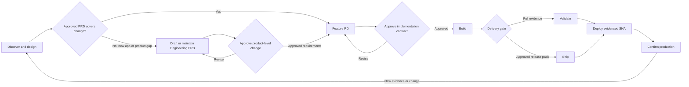

# Wasp AI Development Template

An opinionated Wasp starter with a role-separated, acceptance-criterion-driven
software delivery lifecycle for AI-assisted teams. The process is a repository
contract: agents and humans must satisfy its gates, not merely read its advice.

## Roles

- **Human Product Owner / Release Authority** approves requirements, exceptions,
  external actions, and production releases.
- **Design Agent** creates optional static mockups under `docs/design/mockups/`.
- **Architecture Agent** authors the Engineering PRD, Feature RDs, and
  implementation-plan slices; it does not modify application code.
- **Implementation Agent** builds approved Feature RDs using TDD and records
  observed verification evidence.

## Start here

New to the template? Follow the
[practice task tracker getting-started guide](docs/getting-started-task-tracker.md)
for a complete first application using PostgreSQL, authentication, Feature RDs,
TDD, and the DEAP AI SDLC Playbook.

1. Create a repository using this GitHub template.
2. Read `AGENTS.md` and the [DEAP AI SDLC Playbook](docs/sdlc/README.md).
3. Run `npm install`.
4. Personalize the project:

   ```bash
   npm run bootstrap -- --project-name "Acme Portal" --slug acme-portal --owner "Acme, Inc."
   ```

5. Copy `.env.example` to `.env.server`, set a PostgreSQL connection string,
   and run `npm run database:init`.
6. Optionally add capability packs:

   ```bash
   npm run capability:add -- multitenancy
   npm run capability:add -- railway
   npm run capability:add -- shadcn
   ```

7. Run `npm run sdlc:check`, then `npm run sdlc:validate`.
8. Start the app with `npm start`.

## Identity included from day one

The starter enables account creation and authenticated routes by default. A
person signs up and signs in with an email address; no separate username exists.
The server enforces that the normalized email and Wasp username identity match.

Each user can manage their display name, login email, password, and profile
picture at `/profile`. Profile pictures are stored in PostgreSQL and can be
replaced. Administrative directories, invitations, roles, MFA, and tenant
membership remain explicit application features rather than hidden assumptions.

## Delivery language

- **Build:** implement one approved Feature RD using a failing `AC-*` test and
  focused verification.
- **Validate:** run the complete repository verification gate.
- **Ship:** prepare and publish a reviewed release candidate.
- **Deploy:** release an already validated, unchanged commit.

These words are deliberately distinct. Deploy never silently means “build and
test whatever is currently present.”

## DEAP AI SDLC Playbook

Every material change follows the same controlled sequence:

1. **Discover** the problem, users, evidence, and constraints.
2. **At application inception, define and approve the Engineering PRD** as the
   product-level baseline.
3. **For each feature, check PRD coverage, then specify and approve a Feature
   RD** traced to an existing or automatically maintained requirement.
4. **Build** one approved slice with an `AC-*` failing test first.
5. **Validate** with the full suite when requested, or **Ship** through the
   approved release pack.
6. **Deploy and confirm** that exact evidenced commit in its target environment.

An unmet gate stops progression. Urgency may narrow the artifact, but it does
not erase authorization, testing, rollback, or evidence requirements. Start
with [the canonical DEAP AI SDLC Playbook](docs/sdlc/README.md).



## How adherence is enforced

- `AGENTS.md` gives all AI tools the same working agreement and stop rules.
- The approved Engineering PRD establishes product outcomes, boundaries,
  cross-cutting constraints, and traceable requirements before feature design.
- The Architecture Agent automatically performs a PRD coverage check during
  every Feature RD pass. It leaves the PRD unchanged when coverage already
  exists and proposes a maintained PRD diff only for a real product-level gap.
- Feature RDs turn those requirements into reviewable architecture, acceptance
  criteria, tests, rollout, and rollback before implementation.
- `.github/PULL_REQUEST_TEMPLATE.md` requires contract, evidence, and delivery
  state to be declared during review.
- `npm run sdlc:check` rejects an incomplete Engineering PRD, missing governance
  documents, unindexed Feature RDs, malformed contracts, and premature
  completion claims.
- `npm run sdlc:validate` runs governance checks plus the repository's complete
  technical validation gate.

## Documentation map

- `AGENTS.md`: universal repository working agreement.
- `CLAUDE.md`: Architecture Agent boundary.
- `docs/PRD.md`: approved Engineering PRD and product-level requirements.
- `docs/features/`: Feature RDs and status index.
- `docs/implementation-plan.md`: approved delivery order.
- `docs/sdlc/README.md`: canonical DEAP AI SDLC Playbook and reading order.
- `docs/getting-started-task-tracker.md`: guided first practice application.
- `docs/local-sdlc.md`: concise compatibility guide to the Playbook.
- `docs/testing.md`: test ladder and release evidence.
- `docs/versioning.md`: version policy, update model, and release process.
- `.cursor/rules/`: scoped implementation rules.
- `.agents/skills/`: reusable Codex-compatible workflows.

## Template ownership

Files under `docs/features/`, the PRD, implementation plan, application code,
and project-specific rules belong to the generated application. Shared
methodology files record their source version in `.ai/methodology-version.json`.

## Versions and improvements

The template follows Semantic Versioning. Each published version has an
immutable `vX.Y.Z` Git tag, a GitHub Release, and matching notes in
`CHANGELOG.md`. Run `npm run version:check` to verify version metadata or
`npm run version:bump -- minor` to prepare the next compatible feature release.

Repositories created from this template remain independent snapshots. Use
`.ai/methodology-version.json` and the release notes to review and deliberately
adopt later methodology improvements. See `docs/versioning.md` for the complete
maintainer and update workflow.

## Supported capability packs

- `multitenancy`: organization-scoped data, credentials, jobs, and cross-tenant safety.
- `railway`: Railway deployment and post-deploy verification.
- `shadcn`: installed-primitives-first UI governance.

Packs are explicit and additive. The starter does not assume every application
is multi-tenant, uses Railway, or adopts a particular component library.

