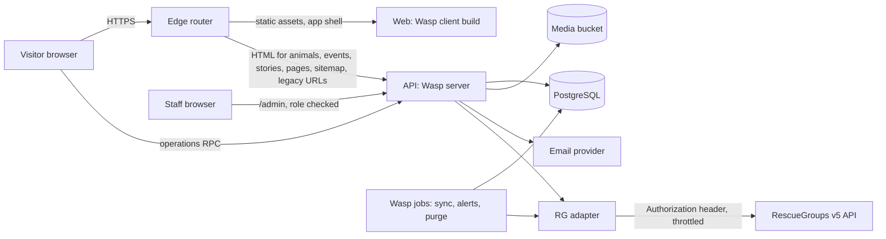

# Architecture: Pet Rescue by Judy Portal

Status: Proposed. Companion to the Engineering PRD ([PRD.md](PRD.md)). Durable
decisions are recorded as ADRs in
[architecture/decisions/](architecture/decisions/) (the repo's ADR location, not
`docs/decisions/`). Feature-level contracts will live in `docs/features/`.

## 1. Context and constraints

| Constraint | Consequence |
|---|---|
| Stack is the DEAP standard Wasp template already in this repo (Wasp ^0.26, TypeScript, React, Node server, Prisma, PostgreSQL) | Not re-litigated. ADR 0001 records it and its costs. |
| RG v5 public API is read-only, beta, animals and orgs only | We own events, stories, pages, applications, accounts, favorites. RG data is a cache behind an adapter. |
| Key in `Authorization` header, server side, Private until launch, then Public | Browser never calls RG. Key only in server env vars. |
| Max page size 250, 429 on abuse | Hourly snapshot sync with a throttled client and backoff. Never per-visitor RG calls. |
| Test API data must never be public | Environment matrix in section 8 enforces it. |
| Applicant PII | Encryption, roles, retention, audit: section 6, ADR 0007. |
| Volunteer-run after launch, low cost | Few moving parts, one language, one database, thin in-app CMS, written runbooks. |

## 2. Recommended stack

| Layer | Choice | Notes |
|---|---|---|
| Framework | Wasp ^0.26 (TS spec), React 19, Vite | Inherited. Wasp-native routes, operations, auth, jobs. |
| Server | Wasp Node/Express server | Operations (queries and actions) for app data; custom API routes only where HTTP semantics are needed (redirects, SEO HTML, sitemap, ICS). |
| Database | PostgreSQL via Prisma | Inherited (NFR-DATA-001). JSONB for versioned form answers and long-tail animal traits; full text search via `tsvector`. |
| Jobs | Wasp `job` (pg-boss, Postgres backed) | RG sync, alert dispatch, retention purge, backup heartbeat. No Redis. |
| Auth | Wasp auth | ADR 0003. Email as identity, verified, with reset. Roles on `User`. |
| UI | Tailwind plus shadcn (shadcn capability pack) | Accessible primitives first. Design tokens from [design-direction.md](design-direction.md). |
| Rich text | Restricted TipTap editor, server side sanitized | ADR 0004. |
| Media | S3 compatible bucket (Railway bucket) plus on-upload resizing | Animal photos hotlink RG; CMS images are ours. |
| Email | Wasp `emailSender` over SMTP or a transactional API | Provider choice is a small decision in the auth Feature RD. |
| Bot defense | Cloudflare Turnstile plus honeypot plus IP rate limit | Verify WCAG conformance of the widget in the application RD. |
| Hosting | Railway: web (static client), api (Wasp server), Postgres, bucket, edge router | ADR 0002. |
| Observability | Structured JSON logs, Sentry (free tier), uptime monitor, job heartbeats | Section 9. |
| Testing | Vitest, Playwright plus axe, adapter contract tests, Lighthouse CI | Delivery plan section 3. |

## 3. System design



Key rules:

1. The browser never talks to RG. Pages read from our database.
2. All domain logic sits in feature modules under `src/<feature>/` with the RG
   JSON:API shape confined to the adapter. UI and Wasp imports stay out of
   domain code, per the repo's architecture rule.
3. Authorization is enforced in every operation and API handler, never only in
   the UI.

### 3.1 RG adapter

```ts
// src/animals/source/AnimalSource.ts (illustrative, not application code yet)
interface AnimalSource {
  listAvailable(opts: PageOpts): AsyncIterable<SourceAnimal[]>
  listAdopted(opts: PageOpts): AsyncIterable<SourceAnimal[]>
  getAnimal(sourceId: string): Promise<SourceAnimal | null>
  getLookups(): Promise<SourceLookups>        // species, breeds, colors, patterns, statuses
  getOrg(): Promise<SourceOrg>
}
```

- `SourceAnimal` is our normalized, source agnostic type. Mapping from JSON:API
  (`data`, `attributes`, `relationships`, `included`) happens only inside
  `RgV5Source`. A `FixtureSource` serves tests and local work. `RgV2Source` or
  `FtpExportSource` can be added later without touching sync, schema or UI.
- Transport: one shared client with a token bucket (start at 2 requests per
  second, concurrency 1), retry on 429 and 5xx with exponential backoff and
  jitter, honoring `Retry-After` if present, and a circuit breaker that pauses
  sync for 30 minutes after repeated failure. `transactionId` from every
  response is logged for RG support tickets.
- Validation: every response is parsed with schemas (zod) at the boundary.
  Unknown fields are ignored; missing required fields fail that record, not the
  run, and are reported in `SyncRun`.
- Contract tests: sanitized recorded fixtures run in CI; a live smoke suite
  against the RG test environment runs on demand and nightly from CI secrets,
  never in the pull request gate. See delivery plan.

### 3.2 Sync

- Hourly job: full snapshot of the `available` view with includes (pictures,
  species, breeds, colors, patterns, statuses, locations), 250 per page. With
  an expected few hundred animals this is a handful of requests, so a full
  snapshot is simpler and more robust than incremental `updatedDate` polling,
  and it makes removal detection trivial (id absent from the snapshot).
- Nightly job: `adopted` view (for Successes and old links), lookups weekly.
- Upsert by `(source, sourceId)`, change detection by payload hash, soft removal
  with `removedAt`. Pictures replaced as a set per animal.
- Status never published as current when `lastSuccessfulSync` is older than
  7 days (RG terms allow weekly at most); the site then shows a notice and
  links to the rescue's RG page. Admin purge action removes all RG derived data
  within one business day of an RG request.
- On demand: Admin can trigger a sync; an animal page can refresh itself at most
  once per 15 minutes per animal.

### 3.3 Rendering and SEO (the main technical risk)

Product Owner direction (2026-11-02): turn on prerendering for SEO wherever
possible. Policy (PRD NFR-SEO-001):

1. **Prerender first.** Every public route without `authRequired` and without
   per-user render output is declared `prerender: true` (Wasp docs: static routes
   take `true`; dynamic routes take an array of concrete paths, which the spec
   file, a Node script, can build at run time). Home, section pages, About,
   Contact, login and signup are prerendered from Feature RD 009 onward.
2. **Dynamic routes get enumerated paths.** For `/animals/:slug`,
   `/events/:slug`, `/stories/:slug` and CMS pages we list the known paths at
   build. Paths not listed still work as client rendered pages.
3. **Prerender rules.** Output must match the client's first render, so avoid
   `window`, `localStorage`, `Date.now()` and locale dependent output in render
   paths; use the `useIsClient` pattern for auth dependent UI.
4. **Gaps handled by an SEO shell.** Wasp 0.26 renders no per request SSR, and
   the prerendering docs do not describe head or meta handling or build-time data
   loading. Where prerender cannot deliver current, data-driven HTML (animal
   status changes hourly), the edge router sends the request to a server handler
   that reads the built `index.html`, injects title, description, canonical,
   Open Graph tags, JSON-LD and a compact content block (name, summary, primary
   image, key facts), and returns it with cache headers. React then takes over on
   the client. The shell also covers CMS edits that must show without a rebuild.
5. **Build data rule.** If a build enumerates animals or content, it reads only
   the production data source. A build must never prerender RG test environment
   data (RG terms: test data is never public).
6. **Freshness.** Prerendered animal pages are rebuilt on a schedule and after
   publish events; staleness is bounded by the rebuild cadence and corrected on
   hydration. The cadence and the exact split between prerender and shell for
   data-driven routes are decided by spike S1 and recorded in an ADR amendment.

Structured data: `AnimalShelter` (a `LocalBusiness` subtype) on the site,
`Event` for events, `Article` for stories, `BreadcrumbList` throughout. Schema.org
has no adoptable pet type that Google rewards, so animal pages use `WebPage`
with `about` set to a `Thing`, keep every fact in visible HTML, and are
validated with Google's Rich Results Test. Do not invent `Product` offers for
adoptions. (To confirm in spike S1.)

Spike S1 (time boxed to 8 hours, after Feature RD 009 proves static
prerendering): determine how head and meta tags work under Wasp prerendering,
whether data-driven pages can be prerendered with build-time data without
hydration mismatch, and prove the shell and edge router on Railway for the cases
prerender cannot cover. Show server delivered HTML for one animal page, run Rich
Results and Lighthouse. Exit criteria and fallback are in the delivery plan. If
S1 fails, the escalation is a decision for the Product Owner (an exception to the
standard stack), not something an agent decides.

Other SEO mechanics: `sitemap.xml` generated from the database, `robots.txt`
(staging disallows all), canonical URLs, 301 for slug changes, `410` for animals
permanently gone, `noindex` for filter combinations beyond the first level.

### 3.4 Legacy redirects

A server handler (reached through the edge router) resolves, in order:
exact rows in `Redirect`, then computed rules:

- `/animals/detail?AnimalID=N` looks up `Animal.sourceId = N`, answers 301 to
  the canonical URL. Adopted animals still resolve (we keep them). Unknown ids
  go to `/animals` with a 302 and are logged for review.
- `/info/<slug>` and `/forms/form?formid=N` use seeded mapping rows built from a
  crawl of the live site plus Barb's page inventory.
- Redirect hits are counted so cutover monitoring can find misses.

## 4. Authorization model

| Role | Can |
|---|---|
| Visitor | Public site, submit applications (if guests allowed), contact and story forms |
| Account holder | Own profile, favorites, alerts, own applications and drafts |
| Editor | CMS content, story moderation, banners, promos, wish list, contact inbox |
| Reviewer | Applications (read, status, notes), contact inbox |
| Admin | Everything, plus users and roles, settings, sync control, retention purge, audit view |

Roles are a column on `User` with a server side `requireRole` helper used by
every admin operation. Editors never receive application data from any query.
Least privilege is tested with a role matrix test suite.

## 5. Accessibility

Native semantics, visible focus, 44 px touch targets, 320 px reflow, no color
only status. Each UI Feature RD inventories controls and states and defines
axe, keyboard, focus, contrast and announcement criteria, per
[accessibility/README.md](accessibility/README.md). The application stepper
uses a real form per step with error summaries that move focus. Admin tables
use semantic tables, not div grids. Turnstile and any embed are checked
separately.

## 6. PII and application handling (summary of ADR 0007)

- Application payload (address, phone, employer, landlord, vet, household,
  free text, certification) is encrypted in the application layer with AES-256
  GCM, key versioned, from env `APP_DATA_KEYS` (key ring, never in repo).
  Plaintext columns are limited to what lists need: reference code, type,
  status, animal, submitter name and email, timestamps.
- Reviewer detail views decrypt on the server and write an audit row. List
  views never decrypt the payload.
- Staff notification emails contain no applicant data, only a link.
- Retention purge job deletes payloads per schedule and keeps a non-sensitive
  tombstone. Backups age out at 30 days.
- Audit log is append only (database trigger blocks update and delete).
- No application file uploads at launch, which removes malware and storage
  risk. Revisit if renter proof of pet deposit moves online.

## 7. Performance

- SPA bundle budget: under 200 KB gzip for the initial route JS; route level
  code splitting; admin code never loads for public visitors.
- Catalog queries hit local indexes; list responses are small projections;
  `Cache-Control` and ETag on read APIs behind the edge router.
- Images: RG supplies `small`, `large`, `original`; use `srcset`, explicit
  dimensions, lazy loading below the fold, priority for the LCP image.
- Fonts self hosted, subset, `font-display: swap`.
- Lighthouse CI budgets and a field Web Vitals beacon (privacy friendly,
  cookieless analytics).

## 8. Environments

| Env | Data | Access | RG |
|---|---|---|---|
| Local | Fixtures plus RG test environment | Developer | Test key, test URL, `FixtureSource` default |
| CI | Fixtures only | GitHub Actions | No key in PR gate; contract smoke job has a secret |
| Staging (Railway) | Production RG data via Private key, synthetic applicants | Password protected, `noindex` | Needs RG confirmation (open question OQ-04) |
| Production (Railway) | Production RG data | Public | Key flipped to Public at launch |

Test environment data is never reachable from any public URL: the production
config refuses to start if `RG_BASE_URL` is a test host (startup assertion plus
test).

## 9. Operations

- Monitoring: uptime checks (home, animal page, API health), sync freshness
  alert (older than 6 hours), error tracking, email delivery failures, job
  heartbeats to a dead man's switch service.
- Backups: nightly encrypted `pg_dump` to a separate bucket, 30 day retention,
  plus Railway's own backups if enabled; quarterly restore rehearsal; RPO 24
  hours, RTO 4 hours. Runbooks extend `docs/operations/deployment.md` and
  `rollback.md`.
- Secrets: Railway variables per environment; rotation procedure documented;
  RG key rotation does not require redeploy of code.
- Migrations: committed Prisma migrations, expand then migrate then contract.
  Code rollback does not reverse a migration; prefer forward fixes.
- Volunteer admin guide (help documentation rule 12) ships with each admin
  feature.

## 10. Trade-offs and rejected alternatives

| Option | Why rejected |
|---|---|
| Next.js, Remix or Astro SSR | Best SEO fit, but replaces the standard stack, the SDLC tooling and capability packs assumed by this repo. Kept as the documented escape hatch if spike S1 fails. |
| WordPress plus RG plugin | Familiar CMS, but weak for encrypted applications and audit, constant patching burden for volunteers, and applications would need plugins that store PII in a shared plugin ecosystem. |
| Headless CMS (Sanity, Strapi, Directus) | Another service, another login, more cost, and our CMS needs are small and structured. |
| Static site plus serverless functions | Cheap, but splits auth, forms and admin across vendors and cannot reuse the template. |
| Query RG live per visitor | Violates rate limits and the beta risk posture; slow; breaks when RG is down. |
| Incremental `updatedDate` sync | Relies on unverified filter semantics and complicates removal detection for a few hundred records. Revisit only if the animal count grows past a few thousand. |
| Mirror RG images into our bucket | Terms treat caching as temporary; hotlinking is explicitly allowed. Revisit only on RG's 30 day notice. |
| Redis or a queue service | pg-boss on Postgres is enough for hourly jobs. |
| Applications pushed into RG | Needs private v2 credentials not requested, and v5 is read-only. Out of scope pending the Product Owner. |
| Email magic link only, no passwords | Attractive for adopters, but Wasp's email-and-password path is the supported one; revisit later. |

## 11. Open architecture risks

1. SEO shell on Wasp (spike S1).
2. RG v5 beta drift (adapter, contract tests, alerting on schema failures).
3. Unverified RG fields (see [data-model.md](data-model.md) section 6).
4. Test harness gap: `npm test` currently runs client tests only; the first
   Feature RD must define server, contract and e2e test commands.
5. Volunteer operability and handover (admin guide, runbooks, simple roles).
