# Data Model: Pet Rescue by Judy Portal

Status: Proposed. Refines the initial draft in the DEAP vault
(`Data-Model.md`, 2026-11-02). Implementation happens only through approved
Feature RDs and committed Prisma migrations. This file is the contract those RDs
start from.

Verification legend used below:

- **Docs**: confirmed present in the RG v5 public docs by this review.
- **Unverified**: taken from the draft or inferred; not seen in a live response.
  No RG API key was available to this session, so nothing here is confirmed
  against a live response yet. Exact calls to close the gap are in section 6.

## 1. Review of the draft: what changed and why

| # | Draft | Problem | Decision |
|---|---|---|---|
| 1 | `animal.id` = RG animal id as primary key | Couples every foreign key to RG; blocks an adapter swap | Internal UUID `id`, unique `(source, sourceId)`; legacy URLs map via `sourceId` |
| 2 | About 90 mirrored columns, one per RG attribute | Brittle against a beta API; huge schema; every RG change is a migration | Promote only filter, sort and card fields to columns; rest in validated `traits` JSONB |
| 3 | `rawJson` stored on every animal | Bloat, and risks storing foster PII if `fosters` is included | Drop in production; store `payloadHash`; log `transactionId` |
| 4 | `contact`, foster `location`, `fosterContactId` mirrored | Private people data with no public use | Never sync `fosters` or contacts; do not request those includes |
| 5 | `org` as a table with `orgId` on animals | Single tenant; one rescue | `OrgProfile` singleton row plus `Setting`; keep `sourceOrgId` string only |
| 6 | Incremental sync via `updatedDate` | Unverified filter semantics; removal detection hard | Hourly full snapshot of `available`, nightly `adopted`; ids absent from the snapshot get `removedAt` |
| 7 | `user.passwordHash`, `role` includes `public` | Wasp owns credentials; "public" is no one | `User.role` enum `MEMBER, EDITOR, REVIEWER, ADMIN` only |
| 8 | `favorite` with nullable animal, breed and species | Overloaded table; cannot express richer alerts | `FavoriteAnimal` plus `AlertSubscription` (criteria JSON); idempotent `AlertDelivery` |
| 9 | `application` with plaintext address, phone, etc. | PII at rest in the clear | `Application` (index) plus encrypted `ApplicationPayload` and `ApplicationNote` |
| 10 | `application_event` only | No record of who looked | Add append-only `AuditLog` for reads, exports, role and setting changes |
| 11 | `imageUrl` strings on events, stories, promos | No alt text, no resizing, link rot | `MediaAsset` with mandatory alt or decorative flag |
| 12 | `page.bodyHtml or blocks` | Undecided; no undo for volunteers | JSON plus sanitized HTML, `PageRevision` history |
| 13 | `setting` holds disclosure text | Legal text is content, not a setting | Locked `Page` block `legal-disclosure`, Admin only |
| 14 | `volunteer_profile` | Volgistics stays external | Deferred (Later) |
| 15 | `event` without timezone or cancel | Evening events and cancellations | Add `timezone` default `America/New_York`, `status` includes `CANCELED`, `.ics` feed |
| 16 | `story` without consent | Public photo and name of adopters | Add `consentedAt`, `submitterEmail` encrypted-at-rest candidate, moderation fields |
| 17 | `redirect` rows only | Animal and form redirects are computed | Rows for fixed paths plus computed rules; add `matchType`, `hitCount` |
| 18 | `sync_run` thin | Cannot diagnose staleness or 429 | Add `status`, `view`, `pagesFetched`, `rateLimitedCount`, and `SyncState.lastSuccessAt` |
| 19 | Animal tags parsed from the name | Name convention may also exist in RG fields | Parse deterministically with tests, keep `rawName`; check RG fields first (V14) |
| 20 | Applicant details (address, phone, employer, landlord, household, pets, vet) stored per application | Typed again on every application; stale copies; more PII copies than needed | `ApplicantProfile` (one encrypted document per user) holds them; applications keep an encrypted frozen snapshot at submit only (Feature RD 010) |

## 2. ER diagram

```mermaid
erDiagram
    User ||--o| ProfileImage : has
    User ||--o{ FavoriteAnimal : saves
    User ||--o{ AlertSubscription : owns
    User ||--o| ApplicantProfile : describes
    User ||--o{ Application : submits
    User ||--o{ AuditLog : acts

    Animal ||--o{ AnimalPicture : has
    Animal ||--o{ AnimalVideoUrl : has
    Animal }o--|| Species : is
    Animal }o--o| Breed : primary
    Animal }o--o| Breed : secondary
    Animal }o--o| Color : colored
    Animal }o--o| Pattern : patterned
    Animal }o--|| AnimalStatus : has
    Animal ||--o{ FavoriteAnimal : favorited
    Animal ||--o{ EventAnimal : attends
    Animal ||--o{ Story : subject
    Animal ||--o{ Application : desired
    Animal ||--o{ AlertDelivery : triggers

    AlertSubscription ||--o{ AlertDelivery : sends

    Application ||--|| ApplicationPayload : encrypted
    Application ||--o{ ApplicationNote : has
    Application ||--o{ ApplicationEvent : timeline

    Event ||--o{ EventAnimal : lists
    Event }o--o| MediaAsset : image
    Story }o--o| MediaAsset : photo
    Promo }o--o| MediaAsset : image
    Page ||--o{ PageRevision : history

    SyncRun }o--|| SyncState : updates
```



## 3. Mirrored entities (cache of RG, rebuildable)

### Animal

| Field | Type | Status | Note |
|---|---|---|---|
| id | uuid PK | n/a | internal |
| source, sourceId | text, unique pair | Docs (id) | `source = "rg5"` |
| slug | text unique | n/a | generated `{nameDisplay}-{sourceId}`; route resolves by trailing id and 301s to canonical |
| rawName, nameDisplay | text | Docs (name) | `nameDisplay` has tags stripped |
| tags | enum[] `FH, TRAINING_CAMP, TRAINING_CAMP_GRADUATE` | Unverified | parsed from name; tests lock the grammar |
| statusId, isAdoptionPending | fk, bool | Unverified | status via `statuses` include |
| availableDate, adoptedDate, sourceCreatedAt, sourceUpdatedAt | timestamptz | Docs | `availableDate`, `adoptedDate`, `createdDate`, `updatedDate` |
| speciesId, breedPrimaryId, breedSecondaryId, colorId, patternId | fk | Docs (includes) | |
| breedString, isBreedMixed | text, bool | Unverified | display and facets |
| sex, isAltered, ageGroup, birthDate, isBirthDateExact | text, bool, text, date, bool | Docs: sex, isAltered, ageGroup, birthDate; rest Unverified | |
| sizeGroup, sizeCurrent, sizeUom | text, numeric, text | Unverified | |
| summary, descriptionText, descriptionHtml | text | Docs | HTML sanitized before display |
| adoptionFeeString | text | Unverified | see V12; policy gives ranges |
| isSpecialNeeds, isNeedingFoster, isCourtesyListing | bool | Docs (views) | |
| isKidsOk, isDogsOk, isCatsOk | bool nullable | Docs | null means unknown, never false |
| isHousetrained, isMicrochipped, isCurrentVaccinations | bool nullable | Unverified | |
| indoorOutdoor, isSponsorable, sponsorshipMinimum | text, bool, numeric | Unverified | |
| pictureCount, videoCount, videoUrlCount, pictureThumbnailUrl | int, int, int, text | Docs | |
| traits | jsonb | n/a | validated long tail: activity, energy, grooming, shedding, vocal, etc. |
| payloadHash, syncedAt, removedAt | text, timestamptz, timestamptz null | n/a | |
| searchVector | tsvector | n/a | name, breed, summary, description |

Not mirrored: `killDate`, `killReason` (shelter only), foster and contact records,
raw payloads.

Indexes: `(source, sourceId)` unique, `slug` unique, `(speciesId, statusId,
removedAt)`, GIN on `searchVector`, and partial indexes for `available`.

### Supporting mirrors

- `AnimalPicture(animalId, order, small, large, original, sourceUpdatedAt)`: Docs.
- `AnimalVideoUrl(animalId, order, url, kind)`: shape Unverified (V8).
- `Species, Breed, Color, Pattern, AnimalStatus`: lookup tables keyed by
  `(source, sourceId)`; refreshed weekly; breeds filtered to species in use.
- `OrgProfile`: single row (name, about, address, phone, email, social, donation
  URLs). Fields Unverified (V9); content owned by `Setting` and CMS where they
  differ.

## 4. Native entities

All tables have `createdAt` and `updatedAt`. Enums are Prisma enums.

### Identity and engagement

- **User** (extends template): `role` enum, `emailVerifiedAt`, `lastLoginAt`.
  Credentials stay in Wasp auth tables.
- **FavoriteAnimal**: `userId`, `animalId`, unique pair.
- **AlertSubscription**: `userId`, `criteria` jsonb (species, breedIds, ageGroup,
  sex, size), `isActive`, `lastEvaluatedAt`. "Favorite a breed" is a subscription.
- **AlertDelivery**: `subscriptionId`, `animalId`, `sentAt`, `channel`; unique
  `(subscriptionId, animalId)` so an animal never alerts twice.

### Applications (sensitive, ADR 0007)

- **ApplicantProfile** (Feature RD 010): `id`, `userId` unique (cascade delete),
  `schemaVersion`, `revision` (optimistic concurrency), `ciphertext` bytea,
  `nonce`, `keyVersion`, `createdAt`, `updatedAt`. No plaintext columns beyond
  these. Plaintext document `ApplicantProfileV1` (zod), fields below.
- **Application**: `id`, `referenceCode` (human friendly, unique, assigned at
  submit, null on drafts), `type` enum `DOG_ADOPTION, CAT_ADOPTION, FOSTER,
  DOG_FOR_A_DAY, VOLUNTEER`, `status` enum `DRAFT, SUBMITTED, IN_REVIEW,
  NEEDS_INFO, APPROVED, DECLINED, WITHDRAWN, COMPLETED`, `userId?` (set null when
  an account is deleted; drafts are deleted), `animalId?` (FK to `Animal`, required
  to submit a cat application), `animalNameSnapshot?`, `submitterName?` and `submitterEmail?` (set at
  submit), `schemaVersion`, `revision`, `furthestStep` (index of the furthest step
  reached, for resume), `lastSavedAt`, `submittedAt?`, `statusChangedAt`,
  `purgeAfter` (drafts: `lastSavedAt` + 30 days; submitted: per ADR 0007).
  Status transitions enforced by a state machine in the domain layer. The
  catalog RD (migration M3) must ship before M4a, which references `Animal`.
- **ApplicationPayload**: `applicationId` unique (cascade), `ciphertext` bytea,
  `nonce`, `keyVersion`. Plaintext is a zod validated document per
  `(type, schemaVersion)`: the application-specific answers, the certification,
  and, only after submit, `profileSnapshot` (a copy of `ApplicantProfileV1`).
- **ApplicationNote** (reviewer RD): `applicationId`, `authorId`, encrypted body.
- **ApplicationEvent**: timeline for reviewers: `draft_created`, `submitted`,
  `status_change`, `note_added`, `email_sent`; no payload data. Step saves are not
  events.
- **AuditLog** (migration M2, skeleton RD): `actorId`, `action`, `targetType`, `targetId`, `at`,
  `meta` jsonb (no PII). Append only by trigger.

#### ApplicantProfileV1 document (encrypted)

Stored once per user and reused by every application type. Values are
`string` unless noted. "Form label" is the live cat form wording (captured
2026-11-02, form 6846) that each field replaces.

| Section | Field | Type and rule | Form label or note |
|---|---|---|---|
| About you | `firstName` | 1 to 100 | First Name |
| | `lastName` | 1 to 100 | Last Name |
| | `addressLine1` | 1 to 100 | Address |
| | `city` | 1 to 50 | City (form limit 25; widened) |
| | `state` | 2 letter US state or territory code | State/Province (form allows 2 characters) |
| | `postalCode` | 5 digits | Zip/Postal Code |
| | `postalCodePlus4` | optional, 4 digits | the "+4" box |
| | `phoneCell` | normalized to 10 digits, displayed `(###) ###-####` | Cell Phone |
| | `dateOfBirth` | ISO date, in the past, age 0 to 120 computed | Age (replaced by date of birth, decided 2026-11-02) |
| | email | not stored here | lives on `User.email`, shown read-only |
| Work | `employerName` | 1 to 150 | Name of Employer and Phone # (split in two) |
| | `employerPhone` | 10 digits | same |
| Housing | `homeOwnership` | enum `OWN, RENT` | Are you the homeowner? (two checkboxes become one choice) |
| | `landlordName`, `landlordPhone` | required when `RENT` | landlord or property manager and phone ("we do call to verify") |
| | `leaseEnds` | optional text, 1 to 100 | If renting, when is your lease up? |
| Household | `householdMembers[]` | 1 to 12 items of `{ fullName: 1..100, age: integer 0..120 }`; at least one (include yourself) | names and ages of those living in the home, first and last names |
| | `hasOwnedPetsBefore` | boolean | Have you owned pets in the past? |
| Pets | `hasCurrentPets` | boolean | derived from the pets question |
| | `currentPets[]` | 0 to 15 items, below | What pets do you currently have? |
| | `currentPets[].name` | 1 to 100 | |
| | `.species` | enum `CAT, DOG, OTHER` | |
| | `.breed`, `.sex`, `.ageText`, `.size`, `.temperament` | short text (sex: enum `MALE, FEMALE, UNKNOWN`) | name, breed, gender, age, size, temperament |
| | `.isSpayedNeutered` | boolean | spayed or neutered? |
| | `.notAlteredReason` | required when not altered, to 300 | If no, please explain |
| | `.vaccinationsCurrent` | boolean | up to date on shots and flea preventative |
| | `.vaccinationNote` | optional, to 300 | |
| | `.felvFivStatus` | enum `NEGATIVE, POSITIVE, NOT_TESTED, NOT_APPLICABLE` (cats) | tested for feline leukemia and FIV |
| | `.notTestedReason` | required when `NOT_TESTED` on a cat | If not tested, why? |
| | `.isDeclawed` | boolean (cats) | Are current cats declawed? |
| | `.declawNote` | required when declawed | why and when |
| Veterinarian | `vetName`, `vetPhone` | 1 to 150, 10 digits | vet for current pets or pets passed in the last two years |
| | `vetRecordsOwnerName` | 1 to 100 | who is listed as the owner on the vet records |

Notes: required means required to submit an application of the type that needs
it, not to save the profile. A profile may be partially filled. Fields the cat
form marks required but that describe the household rather than the cat are
profile fields; fields about this animal or this adoption are application fields.

#### CatApplicationV1 document (encrypted, `type = CAT_ADOPTION`)

| Field | Type and rule | Form label |
|---|---|---|
| `animalId` | required on `Application`, not in the payload; an available cat from the catalog | Which animal are you interested in? (dropdown) |
| `acknowledgesReturnPolicy` | must be `true` to submit | Do you understand PRBJ requires our animals to be returned...? |
| `indoorOutdoor` | enum `INDOOR, OUTDOOR, BOTH` | Will THIS cat be indoor, outdoor or both? |
| `daytimeLocation` | 1 to 200 | Where will pet be kept when you are not home? |
| `plansToDeclaw` | boolean | Are you planning to declaw your newly adopted cat? |
| `declawReason` | required when `plansToDeclaw` | if yes, why |
| `behaviorPlan` | 1 to 2000 | If you adopt a cat and it develops undesirable behavior, what will you do? |
| `referralSource` | optional, to 1000 | How did you hear about Pet Rescue By Judy? |
| `comments` | optional, to 2000 | Comments / anything else (live form marks it required; see RD 010 open decisions) |
| `certification.typedName` | 1 to 150 | APPLICATION CERTIFICATION, name |
| `certification.textVersion` | string, set by server | which certification wording was shown |
| `certification.certifiedAt` | server timestamp | the date |
| `profileSnapshot` | `ApplicantProfileV1`, server copied at submit | n/a |

### Content

- **Page**: `slug` unique, `title`, `bodyJson`, `bodyHtml` (sanitized), `status`,
  `seoTitle`, `seoDescription`, `isLocked`, `updatedById`, `legacyPaths` text[].
- **PageRevision**: `pageId`, `bodyJson`, `savedById`, `savedAt` (keep last 20).
- **Event**: `title`, `slug`, `startsAt`, `endsAt`, `timezone`, `allDay`,
  `locationName`, `address`, `mapUrl`, `imageId`, `bodyJson`, `bodyHtml`,
  `status` `DRAFT, PUBLISHED, CANCELED`, `isFeatured`.
- **EventAnimal**: `eventId`, `animalId`.
- **Story**: `title`, `slug`, `animalId?`, `animalNameSnapshot`, `bodyJson`,
  `bodyHtml`, `photoId`, `authorName`, `submitterEmail?`, `consentedAt?`,
  `status` `PENDING, PUBLISHED, REJECTED`, `publishedAt`, `sortName`.
- **Banner**: `key` (`surrender_capacity`, `announcement`), `message`, `isActive`,
  `startsAt`, `endsAt`.
- **Promo**: `title`, `imageId`, `linkUrl`, `sortOrder`, `isActive`.
- **WishlistItem**: `category`, `text`, `linkUrl?`, `sortOrder`, `isActive`.
- **MediaAsset**: `storageKey`, `mime`, `width`, `height`, `variants` jsonb,
  `alt`, `isDecorative`, `uploadedById`. Publish blocked without alt or the flag.
- **Setting**: typed keys (PayPal URL, Venmo handle, Amazon and Chewy lists,
  social URLs, phone, address, emails). Validated by zod.
- **ContactMessage**: `name`, `email`, `subject`, `message`, `status`,
  `receivedAt`, `purgeAfter` (12 months). Treated as PII.
- **Redirect**: `fromPath`, `matchType` `EXACT, PREFIX, QUERY`, `toPath`,
  `status` (301 default), `source` `SEED, ADMIN`, `hitCount`, `isActive`.

### Operations

- **SyncRun**: `view`, `startedAt`, `finishedAt`, `status`, `pagesFetched`,
  `fetched`, `upserted`, `removed`, `rateLimitedCount`, `error`, `transactionId`.
- **SyncState**: per source and view: `lastSuccessAt`, `lastAttemptAt`,
  `consecutiveFailures`, `pausedUntil`.

## 5. Migration plan

Principles: committed Prisma migrations, expand then migrate then contract,
each migration reviewed for data impact and rollback, tested on empty and
seeded databases, shipped with the Feature RD that needs it. The existing
`User` and `ProfileImage` tables are kept.

| Order | Migration | Feature | Rollback |
|---|---|---|---|
| M1 | `User.role`, `emailVerifiedAt`, `lastLoginAt` (default `MEMBER`) | Auth upgrade | Additive; drop columns |
| M2 | `AuditLog` plus append-only trigger; `Setting`, `Redirect` | Skeleton | Drop tables |
| M3 | Lookups, `Animal`, `AnimalPicture`, `AnimalVideoUrl`, `SyncRun`, `SyncState`, search vector and indexes | Catalog and sync | Drop tables (cache, rebuildable) |
| M4a (after M3) | `ApplicantProfile`, `Application`, `ApplicationPayload`, `ApplicationEvent`, enums | Cat application wizard and profile (RD 010) | Drop tables only before real data exists; after launch use forward fixes |
| M4b | `ApplicationNote` (needs `AuditLog` from M2) | Reviewer workflow RD | Drop table before notes exist; then forward fixes |
| M5 | `MediaAsset`, `Page`, `PageRevision`, `Event`, `EventAnimal`, `Story`, `Banner`, `Promo`, `WishlistItem`, `ContactMessage` | CMS | Forward fixes after content exists |
| M6 | `FavoriteAnimal`, `AlertSubscription`, `AlertDelivery` | Accounts | Drop tables |
| M7 | Seed `Redirect`, `Page`, `Setting` from migration scripts and crawl output | Content migration | Idempotent seeds keyed by slug |

Data migration (non-schema): content export from the RG CMS (pages, events,
stories, flyers) is imported by a reviewed, idempotent script run from an
admin task, with a diff report; originals are archived outside the repo.
Application forms are rebuilt, not migrated; no applicant data moves from RG.

## 6. Verification plan against the RG test environment

Run from a developer machine with the key in an environment variable. Never
paste, echo or commit the key; save responses outside the repo and sanitize
before turning any into fixtures. The test base URL below comes from the draft
and is Unverified; confirm it in the RG docs. Test data must not reach any
public site.

```bash
export RG_BASE=https://test1-api.rescuegroups.org/v5   # confirm URL
H=(-H "Content-Type: application/vnd.api+json" -H "Authorization: $RG_API_KEY")
```

| ID | Call | Answers |
|---|---|---|
| V1 | `curl -sS "${H[@]}" "$RG_BASE/public/animals/search/available/?limit=1&include=pictures,species,breeds,colors,patterns,statuses,locations,orgs,videos,videourls"` | Full attribute set, include shapes, which fields are real (slug? ageString? sizeCurrent?) |
| V2 | same with `&include=fosters` | Whether foster data is exposed publicly and what PII it holds (we will not use it) |
| V3 | `.../search/available/?limit=0` | `meta` shape, `count`, `pages`, `transactionId` |
| V4 | `POST .../search/available/` with a `filters` body on `animals.updatedDate` or `animals.name` | Whether a view plus a body filter works (docs contradict); filter syntax and exact body shape |
| V5 | `GET .../search/available/?sort=-animals.updatedDate&limit=5` | Sort field names |
| V6 | `GET /public/animals/{id}` for an adopted id and for a bogus id | Detail visibility for adopted animals; 404 vs empty for removed |
| V7 | `GET /public/animals/search/adopted/?limit=1` | Adopted view support, `adoptedDate`, how many exist |
| V8 | Find an animal with `videoCount` or `videoUrlCount` above 0, fetch with `include=videos,videourls` | Video shapes |
| V9 | `GET /public/orgs/{id}` and the org animals path | Org fields we display; the id for account 1023 |
| V10 | `GET /public/animals/species`, `/breeds?limit=10000`, `/colors`, `/patterns`, `/statuses` | Lookup shapes and sizes |
| V11 | `GET .../search/available/?fields[animals]=name,sex,ageGroup&limit=1` | Sparse fieldset names usable by the adapter |
| V12 | Compare `adoptionFeeString` across 20 animals | Whether fee is only a string; values vs policy ranges |
| V13 | `GET .../search/attending/?limit=1`, check `eventsAttendingCount` | Whether event attendance exists in the public data |
| V14 | Filter `animals.name contains FH` and `TRAINING CAMP` | Real tag grammar (prefix, suffix, case) and whether RG has a structured equivalent |
| V15 | Response headers via `-D headers.txt -o /dev/null` on one call | Any rate limit headers, `Retry-After` on 429 (do not provoke a 429) |
| V16 | `GET .../search/available/?postalcode=32771&distance=30` (confirm parameter names in docs) | Geodistance support for foster radius features |
| V17 | Production call with the Private key, `limit=1` | Whether a Private key can read production data for staging (OQ-04) |

Results are recorded in `docs/data-model.md` (status column) by the Architecture
Agent and as sanitized fixtures by the Implementation Agent.

## 7. Relationships summary

- One `Animal` has many pictures and video urls; belongs to one species and status.
- One `User` has many favorites, subscriptions and applications, and one encrypted `ApplicantProfile`.
- One `Application` has one encrypted payload and many notes and events.
- `Event` to `Animal` many to many; `Story` to `Animal` optional many to one.
- `Page` has revisions; all images go through `MediaAsset`.
