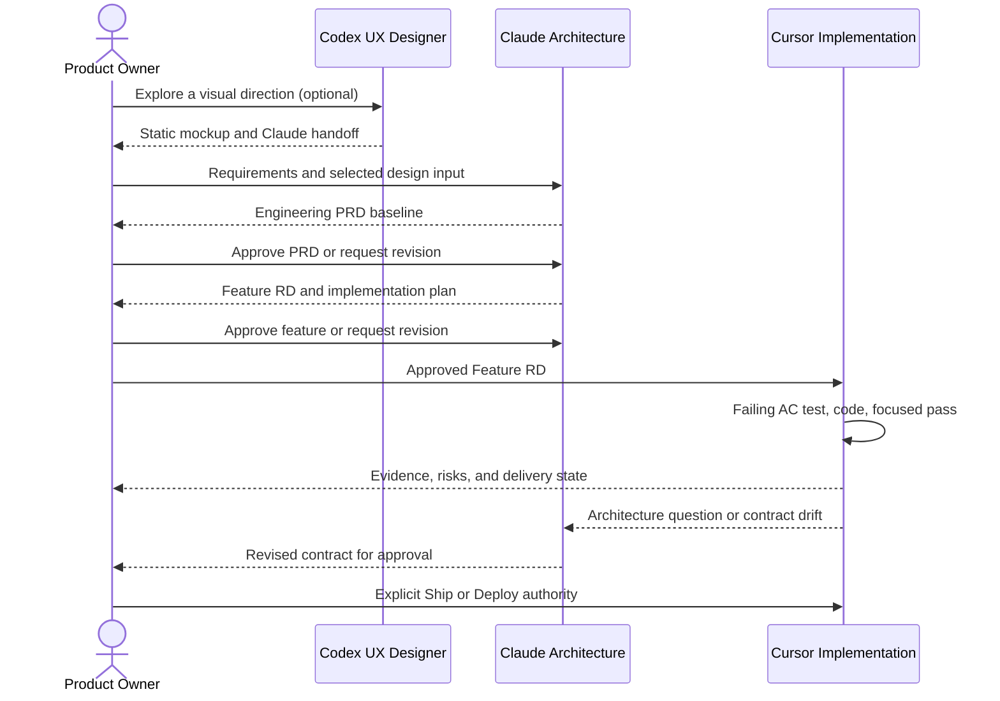

# 1. Principles and Authority

## Operating principles

1. **The approved contract precedes code.** Material behavior begins with a
   traceable requirement and an approved Feature RD.
2. **Authority is explicit.** Agents recommend and execute within bounded
   roles; humans approve requirements, exceptions, external actions, and
   production releases.
3. **Evidence outranks confidence.** Completion claims cite observed results.
   Missing, skipped, stale, or environment-blocked checks remain visible.
4. **Security and accessibility are design inputs.** They are acceptance
   criteria, not final-stage reviews.
5. **The smallest approved slice wins.** Avoid speculative infrastructure,
   unrelated cleanup, and silent re-architecture.
6. **Persisted data changes are reversible.** Schema work includes committed
   migrations, compatibility analysis, and rollback or recovery guidance.
7. **Production is a separate system state.** Merge, release, deployment, and
   live verification are distinct facts.

## Decision rights

| Decision or action | Design | Architecture | Implementation | Human authority |
|---|:---:|:---:|:---:|:---:|
| Explore interaction concepts | R | C | C | A |
| Define requirements and priorities | C | C | C | A/R |
| Author Engineering PRD, architecture, and Feature RD | C | R | C | A |
| Approve Engineering PRD baseline | C | C | C | A/R |
| Approve Feature RD | — | C | — | A/R |
| Implement approved behavior | — | C | A/R | C |
| Change approved scope | — | R | C | A |
| Record verification evidence | C | C | R | A |
| Commit or push | — | — | R | A |
| Ship, deploy, or roll back | — | C | R | A |

`R` is responsible, `A` is accountable, and `C` is consulted. The human
Product Owner / Release Authority remains accountable for consequential
external state changes.

## Hard three-agent boundary

- **UX Designer (ChatGPT Codex):** optional static mockups under
  `docs/design/mockups/<slug>/` only. Mockups are design input, never
  requirements or architecture truth. The handoff goes to Claude, not Cursor.
- **Architecture Agent (Claude Code):** authors the Engineering PRD, Feature RDs,
  implementation-plan slices, and governance documents. It does not implement
  application code or certify its documentation by running the implementation
  gate. In a Claude session, “Build” means finalize the RD and plan for Cursor.
- **Implementation Agent (Cursor):** implements only an approved Feature RD,
  writes AC-mapped tests, runs gates, records evidence, and performs explicitly
  authorized git and deployment work. It consumes the Feature RD, not an
  upstream mockup.
- **Human Product Owner / Release Authority:** approves the RD and material
  changes, resolves exceptions, and authorizes consequential external actions.

An agent does not absorb another role because doing so is convenient. Separate
concurrent agents use separate worktrees or clones.

## Stop conditions

An agent stops and reports when:

- requirements or acceptance criteria conflict;
- the Feature RD is missing, unapproved, or materially incomplete;
- implementation requires unapproved schema, authorization, dependency, or
  external-service changes;
- current repository state differs materially from the specification;
- required verification cannot run or produces unexplained failures;
- the intended branch, commit, environment, credentials, or deployment target
  cannot be confirmed;
- unrelated user or agent changes would be overwritten.
