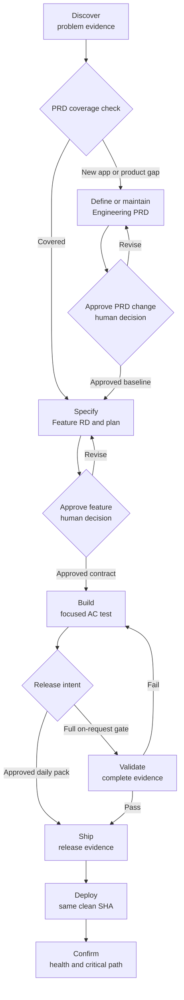

# 2. Lifecycle and Quality Gates

## Gate model

| Stage | Required input | Required output | Exit authority |
|---|---|---|---|
| Discover | Product problem or opportunity | Evidence, constraints, open questions | Product Owner |
| Check PRD coverage | Discovery evidence and proposed change | Coverage result and impacted requirement IDs | Architecture Agent |
| Define or maintain PRD | New application or uncovered product-level change | Proposed PRD baseline or focused diff | Architecture Agent |
| Approve PRD | Reviewable baseline or material diff | Approved product baseline | Product Owner |
| Specify | Approved PRD requirement | Proposed Feature RD and plan slice | Architecture Agent |
| Approve feature | Reviewable Feature RD | Approved implementation contract | Product Owner |
| Build | Approved Feature RD | Passing focused AC tests and implementation | Implementation Agent |
| Validate | Completed build | Full evidence record with limitations | Implementation Agent |
| Ship | Authorized clean commit and approved release pack | Immutable, evidenced release candidate | Release Authority |
| Deploy | Authorized unchanged release | Target-specific deployment result | Release Authority |
| Confirm | Deployed release | Health, migration, and critical-path evidence | Release Authority |

## Gate rules

### Discover gate

- Identify users, present behavior, problem, measurable outcome, constraints,
  and evidence versus assumptions.
- Design artifacts may explore possibilities but cannot set architecture,
  permissions, data retention, or feasibility.

### Engineering PRD gate

- Define the product purpose, users, problems, measurable outcomes, boundaries,
  domain model, system context, security, data, accessibility, reliability,
  integration, deployment, and operational constraints.
- Give every functional and non-functional requirement a stable identifier.
- Separate evidence, assumptions, decisions, and unresolved questions.
- Create and explicitly approve the complete baseline once at application
  inception. Approval establishes a baseline; it does not freeze learning.
- On each later architecture pass, automatically check the requested feature
  against approved requirement IDs and cross-cutting constraints.
- When coverage exists, record the cited IDs in the Feature RD and do not edit
  or reapprove the Engineering PRD.
- Only when product intent, scope, users, ownership, or a cross-cutting
  constraint genuinely changes does the Architecture Agent maintain the PRD and
  present its focused diff for renewed approval before dependent Feature RDs.

### Specification gate

- Trace the change to one or more approved Engineering PRD requirement IDs.
- Inspect current code and tests before proposing architecture.
- Define in-scope and out-of-scope behavior, data and authorization effects,
  acceptance criteria, tests, rollout, rollback, and open decisions.
- Add the Feature RD to the index and approved delivery order.

### Approval gate

- Status becomes `Planned` only after explicit human approval.
- Unresolved decisions that affect behavior, risk, cost, or scope block Build.
- Approval applies to the written revision, not an earlier conversation.

### Build gate

- Begin with a failing test mapped to an approved `AC-*` criterion.
- Implement the smallest conforming slice.
- Run the focused AC test; do not silently turn Build into the full gate.
- Add the required browser specification for user-visible route or behavior
  changes, even when it will run later at Validate or Ship.
- Do not mark criteria complete merely because code exists.

### Validation gate

- Run `npm run sdlc:validate` from the intended commit state.
- Report exact results, skipped checks, known failures, environmental limits,
  migrations, browser checks, and manual evidence.
- Required unexplained failures block Ship.

### Ship and deployment gates

- Ship runs the application's approved release pack. Until a smaller pack is
  explicitly designed, this starter uses the full validation gate.
- Confirm clean worktree, intended branch and SHA, approval, release version,
  changelog, and current evidence. Record what Ship did and did not prove.
- Deploy the same immutable SHA that passed validation.
- Deploy never creates code, silently runs a missing gate, or changes the SHA.
- Confirm database migrations, service health, critical user path, and rollback
  readiness in the target environment.
