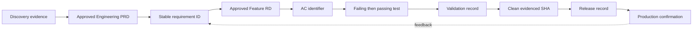

# 5. Validation and Evidence

## Evidence standard

Evidence is reproducible, attributable to the current code state, and explicit
about limitations. “Looks good,” an agent report, or a command exit without
relevant assertions is not sufficient.

Every completion claim should be traceable across this chain. A missing link
limits the furthest delivery state that may be reported.

## Test ladder

| Layer | Typical purpose | Examples |
|---|---|---|
| Pure unit | Deterministic rules and transformations | Vitest functions |
| Component/contract | UI state and repository contracts | Render/contract tests |
| Integration | Database, operation, and service boundaries | PostgreSQL-backed tests |
| Compile/build | Generated types and production construction | `wasp compile` |
| Browser | Real routes and user workflows | Playwright |
| Accessibility | Keyboard, names, focus, contrast, reflow | axe plus manual checks |
| Operational | Migration, deployment, health, rollback | Target-specific smoke |

Use the lowest layer that proves the criterion, then add higher layers for
integration risk. Browser tests do not replace unit tests; unit tests do not
prove routing, database, or deployment behavior.

## Required validation record

Record:

- branch and commit SHA, plus whether the tree was clean;
- exact commands and environment;
- passed, failed, skipped, and flaky totals;
- Feature-RD criteria covered;
- compilation/build result;
- migration and database result;
- browser and accessibility result when applicable;
- manual checks and what they add beyond automation;
- known failures, limitations, and baseline comparisons.

After a green Validate, the Implementation Agent updates the Feature RD
checkboxes and Verification section, records the plan evidence, and synchronizes
the Feature-RD index. User-visible changes also receive a structured manual
smoke checklist naming the role, route, actions, expected results, and an edge
case. The checklist explains what automation already proved.

## Evidence freshness

Evidence becomes stale when relevant code, generated dependencies, schema,
configuration, migration order, or target environment changes. Ship and Deploy
must use evidence for the exact candidate or rerun the affected gates.

## Failure policy

- A new failure blocks progression.
- A pre-existing failure requires a reproduced baseline and documented impact;
  it is never silently relabeled unrelated.
- A skipped required test is an open criterion.
- Flaky tests are failures of reliability until their behavior and disposition
  are documented.
- Environmental blockage is reported as blockage, not a pass.
