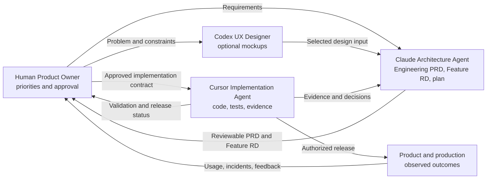
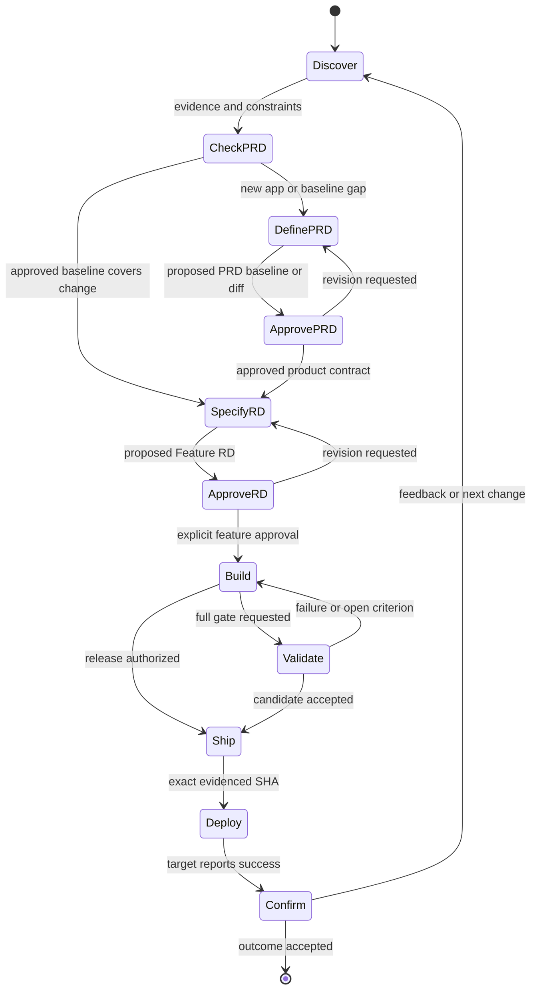

# DEAP AI SDLC Playbook

This repository treats software delivery as a governed evidence system, not a
sequence of prompts. Every material change moves through explicit authority,
an approved contract, implementation, verification, and release gates.

This Playbook is the reusable form of the active three-agent methodology in
DEAPOpsManager-Internal. It preserves that methodology's hard UX Designer /
Claude Architecture Agent / Cursor Implementation Agent separation,
Feature-RD approval gate, AC-mapped TDD, exact evidence, and distinct Build,
Validate, Ship, and Deploy commands. Product-specific DEAP rules are not copied
unless they are universal delivery controls.

## Cross-functional operating model



The agents are specialized, not isolated. They exchange controlled artifacts
and evidence while preserving hard writable-scope and decision boundaries.
Codex never hands a mockup directly to Cursor; Claude turns the selected design
input into a reviewable contract; Cursor stops when implementation reveals a
missing architecture decision; the human remains the approval and release
authority.

## Non-negotiable workflow



No agent may silently collapse these stages. A request to build does not
authorize shipping. A successful deployment command does not prove production
behavior. A passing test does not approve changed scope.

The full Engineering PRD is created at application inception. It is not a
per-feature paperwork step. On each later architecture pass, Claude checks
whether the proposed Feature RD is already covered by approved requirement IDs
and cross-cutting constraints. If it is, the PRD remains untouched. If it is
not, Claude maintains the PRD as part of that same pass and presents only the
product-level diff and its Feature-RD impact for human approval.

`Ship` is a deliberate release path, not a synonym for `Validate`. A generated
application may configure Ship as a focused daily gate and Validate as the full
on-request suite, as DEAPOpsManager does. This starter initially makes Ship use
the full validation command until the application defines and approves a
smaller always-on release pack.

## Playbook chapters

1. [Principles and authority](01-principles-and-authority.md)
2. [Lifecycle and quality gates](02-lifecycle-and-gates.md)
3. [Engineering PRD and Feature RDs](03-requirements-and-feature-rds.md)
4. [Engineering workflow and TDD](04-engineering-and-tdd.md)
5. [Validation and evidence](05-validation-and-evidence.md)
6. [Release, deployment, and rollback](06-release-deployment-and-rollback.md)
7. [Change control and exceptions](07-change-control-and-exceptions.md)

## Sources of truth

| Question | Authoritative artifact |
|---|---|
| Why does the product exist and what must it do? | Approved `docs/PRD.md` Engineering PRD |
| What behavior is approved? | Relevant `docs/features/NNN-*.md` |
| What is built next? | `docs/implementation-plan.md` |
| Who may decide or act? | This Playbook and `.ai/roles.yaml` |
| How is behavior proven? | AC-mapped tests and recorded verification |
| What is currently implemented? | `docs/features/000-overview.md` plus observed evidence |
| What was released? | `CHANGELOG.md`, immutable tag, and release record |

When sources conflict, stop. The Product Owner resolves product intent; the
Architecture Agent reconciles the written contract before implementation.

## Required commands

```bash
npm run sdlc:check
npm run sdlc:validate
```

`sdlc:check` verifies the Engineering PRD structure, methodology structure, and
Feature-RD contracts.
`sdlc:validate` runs that check plus the repository's complete automated gate.
